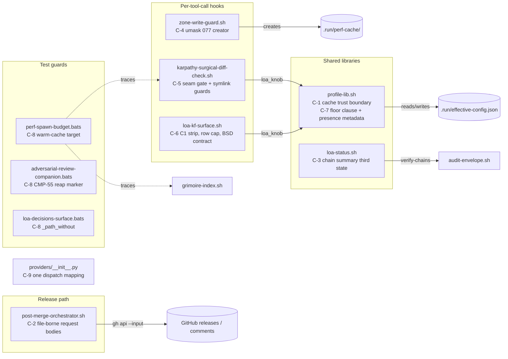

# Software Design Document: Hardening follow-ups (cycle-138)

**Version:** 1.1
**Date:** 2026-10-29
**Revision:** 1.1 carries PRD 1.1's Flatline integration into the design (§ 11.G): the profile-lib trust predicate covers the cache file and refuses a writable `.run` with zero added spawns; the publisher's body files have checked failure paths and their own trap scope; the chain summary classifies every primitive; the trajectory guard covers components, ownership, type and links; the KF cap separates selection from display with a byte ceiling and the full control class; FR-9 needs a prebuilt-BWK attempt before form (b).
**Author:** Architect Agent (Claude Fable 5.1, unattended)
**PRD Reference:** `grimoires/loa/prd.md` (1.1, FR-1 … FR-16, G-1 … G-4, Appendix D)
**Status:** Draft — autonomous cycle on the operator's instruction of 2026-10-29
**Cycle:** `cycle-138-hardening-followups`, branch `feature/cycle-138-hardening-followups` from `main` fe52be893
**Integration context:** `grimoires/loa/a2a/integration-context.md` is absent; the cycle-137 and sprint-bug-283 artefacts (`grimoires/loa/archive/cycle-137-performance-followups/`, `grimoires/loa/a2a/sprint-282/`, `grimoires/loa/a2a/bug-20261028-90f357/`) are the prior art every component below cites.

---

## Table of Contents

1. Project Architecture
2. Software Stack
3. Database Design
4. UI Design
5. API Specifications
6. Error Handling Strategy
7. Testing Strategy
8. Development Phases
9. Known Risks and Mitigation
10. Open Questions
11. Appendix

---

## 1. Project Architecture

### 1.1 System Overview

Fifteen bounded changes to an existing bash/awk/python framework, grouped into ten components (C-1 … C-10) that touch six System Zone files, one Python package and five test files. Nothing new is deployed; every component is a hardening of a path that already runs on the maintainer's machine: three per-tool-call hooks (zone-write-guard, karpathy, the KF SessionStart surface), two shared libraries (`profile-lib.sh`, `loa-status.sh`), the post-merge publisher, and the test guards that keep them honest.

> From prd.md: "Every change keeps its hot path's spawn budget … where output changes by design (FR-3, FR-7) the change is enumerated; everything else is byte-identical old-versus-new" (§ Non-Functional Requirements → Performance).

### 1.2 Architectural Pattern

The cycle-137 pattern, unchanged: **fast path with a verbatim fallback, trust boundary before any cache read or write, red-first tests with a parity harness in real directories, manifests regenerated per System Zone commit**. Where cycle-137 introduced a boundary for one cache (`_gi_trusted_dir`, `_gi_dec_write`), this cycle applies the same boundary to its older sibling and the same "inputs through files, never argv" rule sprint-bug-283 established for the publisher's read-back to its write side.

### 1.3 Component Diagram



### 1.4 Components

| ID | Component | Files | PRD |
|---|---|---|---|
| C-1 | profile-lib cache trust boundary | `.claude/scripts/lib/profile-lib.sh` | FR-1 |
| C-2 | publisher file-borne request bodies | `.claude/scripts/post-merge-orchestrator.sh` | FR-2 |
| C-3 | chain summary third state | `.claude/scripts/loa-status.sh` | FR-3 |
| C-4 | umask-077 perf-cache creators | `.claude/hooks/safety/zone-write-guard.sh` (+ any other creator found by `grep -rn 'perf-cache' .claude --include='*.sh'` that runs `mkdir`) | FR-4 |
| C-5 | karpathy seam gate + trajectory symlink guards | `.claude/hooks/quality/karpathy-surgical-diff-check.sh` | FR-5, FR-6 |
| C-6 | KF surface: C1 strip, row cap, BSD contract | `.claude/hooks/loa-kf-surface.sh`; `.claude/scripts/grimoire-index.sh` (`SAN_AWK` twin only) | FR-7, FR-8, FR-9 |
| C-7 | profile-lib floor descendant clause + presence metadata | `.claude/scripts/lib/profile-lib.sh` | FR-10, FR-11 |
| C-8 | test guards | `tests/unit/perf-spawn-budget.bats`, `tests/unit/adversarial-review-companion.bats`, `tests/unit/loa-decisions-surface.bats` | FR-12, FR-13, FR-14 |
| C-9 | provider dispatch mapping | `.claude/adapters/loa_cheval/providers/__init__.py` | FR-15 |
| C-10 | ship | PR, Bridgebuilder, merge, record, archive (no publish) | FR-16 |

> Sources: prd.md § Technical Considerations → Architecture; the file anchors in each FR

---

## 2. Software Stack

### 2.1 Languages and runtimes
bash 5.2 on the ship host, bash 3.2 compatibility kept where the touched file already has it (hooks: no associative arrays, no `${var,,}`, `[[ ]]` only); awk (mawk 1.3.4, busybox awk, `gawk --posix`; BWK one-true-awk for C-6 form (a)); jq 1.7 (≥ 1.6 for `$ARGS`); mikefarah yq 4.44.1; python3 3.13 (`-I` for the publisher's helpers, as sprint-bug-283 did); bats-core 1.13.0 via the npx cache (`/home/merlin/.cache/npm/_npx/cd2c4d46c11457b7/node_modules/.bin`).

### 2.2 Build and verification
`red-test-check.sh --env-pass PYTHONUSERBASE` per red commit; `tools/gen-checksums.sh --root`, `--check`, `repo-map-gen.sh` + `--validate`, `tools/check-manifest-paths.sh`, `check-loa.sh` under the bounded zone marker (`~/.cache/loa/cycle-137/scripts/regen-manifests.sh` is the recipe); `perf-spawn-budget.bats`; mirror parity in REAL directories (`mirror-ls.py` pattern: python writes, because the shell fence refuses `cp`/redirects into any path containing `.claude/`).

### 2.3 External services
GitHub through `gh` (PR, checks, merge; the publisher's `gh api --input -` already reads request JSON from stdin — C-2 only moves how that JSON is *built*). No model calls on any hot path; the dissent and Bridgebuilder voices are the cycle's review tooling, not the product.

> Sources: `grimoires/loa/a2a/sprint-282/e2e.md` § Measurements (host); `grimoires/loa/a2a/bug-20261028-90f357/reviewer.md` (python3 -I, temp-dir pattern)

---

## 3. Database Design

No database. One existing file cache changes its trust rules (C-1) and one directory its creation mode (C-4):

| File | Owner | Reader | Writer rule (C-1) | Trust rule (C-1) |
|---|---|---|---|---|
| `.run/effective-config.json` (`schema_version 1`, `id`, `knobs`, `profile_keys`, `overrides`, `warnings`) | `profile-lib.sh` | `_loa_pl_load`, `loa_knob` warm path | `umask 077` subshell; `mktemp "$cache.XXXXXX"` beside the cache; `[[ ! -L cache ]]` re-check; `mv -f -T` (fallback `mv -f` only when the target is neither a directory nor a symlink); the rename replaces a planted file or hard link, never truncates through it; failure removes the temp and leaves the cache untouched | **trust predicate** (PRD 1.1 FR-1, DEC-1157): (a) the cache's directory is a real directory (`-d && ! -L`), owned by `$EUID`, with no group/other write bit — a writable or foreign directory is REFUSED (cache off, live read); profile-lib never `chmod`s from the hook path (the D-5.3 tightening stays in `grimoire-index.sh`); (b) the cache file, when present, is a regular non-symlink file owned by `$EUID`, no group/other write bit, link count 1 — else not read, replaced on the next write; (c) a redirected `LOA_PROFILE_CACHE_FILE` outside bats keeps its WARN and its directory must satisfy (a) with no symlinked path component (`realpath -m` equals the literal path); the predicate is evaluated once per process from the stat rows below; a directory that becomes trusted again does not have its existing cache read (rebuild) |
| `.run/perf-cache/` | `zone-write-guard.sh` (first creator on a fresh mount), grimoire-index (`_gi_dec_write`, already 077) | the caches of cycle-137 | created inside `( umask 077; mkdir -p … )` by every creator (C-4) | unchanged readers (`_gi_trusted_dir`) |

**Spawn budget for C-1.** `_loa_pl_id` already runs one `stat -Lc '%n|%y|%s'` over the three source files; the trust predicate extends THAT call with the cache's directory and the cache file as fourth and fifth paths and the format `|%a|%u|%h` (mode, uid, link count; BSD: `stat -Lf '%N|%Fm|%z|%Lp|%u|%l'`), parses the two extra rows (a missing cache file simply yields no row), and excludes them from the cache `id` (ids stay byte-identical to today's, so the cache is not rebuilt by a mode change). Ownership is read from the stat row rather than `[[ -O ]]` so the fixtures can shim it. Net: **zero additional spawns** on the warm karpathy path (budget stays 196 / 9); no `chmod` is ever issued from profile-lib (DEC-1157). The `realpath -m` check for a redirected cache path runs only when `LOA_PROFILE_CACHE_FILE` is set outside bats (one spawn on that seam path only).

> Sources: `.claude/scripts/lib/profile-lib.sh:50-83, 181-222`; `.claude/scripts/grimoire-index.sh:263-331`; `.claude/hooks/safety/zone-write-guard.sh:255-264`; DEC-1126

---

## 4. UI Design

Command-line text only. Three operator-visible changes, each enumerated in the sprint report and the CHANGELOG `[Unreleased]`:

| Surface | Before | After (C-3, C-6) |
|---|---|---|
| `loa-status` human line | `Audit chain: 7/7 primitives validate.` (absence counted valid) | `Audit chain: 7/7 primitives validate.` only when every chain file exists and verifies; otherwise `Audit chain: V/7 validate (A absent, B broken).` |
| `loa-status --json` `agent_network` | `audit_chain_summary: "V/7"` | `audit_chain_summary: "V/7"` (V now excludes absent) **plus** `audit_chain: {valid, absent, broken, total}` |
| KF SessionStart table | every entry (65 today) | at most `KF_SURFACE_MAX_ROWS` (40) rows ordered by recurrence desc, id desc, then `  … and K more — see grimoires/loa/known-failures.md` |

No colour-only signal (`agent-ergonomics-color-guard.bats`). Everything else byte-identical.

> Sources: `.claude/scripts/loa-status.sh:481-522`; `.claude/hooks/loa-kf-surface.sh:88-140`; prd.md § User Experience

---

## 5. API Specifications

No network API changes. The "APIs" here are the shell-function contracts each component changes; pseudocode is the specification.

### 5.1 `profile-lib.sh` cache trust boundary (C-1)

```
_loa_pl_paths():            unchanged (root, cfg, prof, floor, cache path; LOA_PROFILE_CACHE_FILE seam)
_loa_pl_id():
  st = stat -Lc '%n|%y|%s|%a|%u|%h' -- cfg prof floor "$cachedir" "$cache"   # GNU; BSD: -Lf '%N|%Fm|%z|%Lp|%u|%l'; a missing cache yields no row
  rows = split(st, "\n"); src = rows for cfg/prof/floor; dirrow = the row for cachedir; filerow = the row for cache (may be absent)
  _LOA_PL_CUR_ID = "v1|cfg|prof|floor|" join(src with |%a|%u|%h stripped, ";")      # id bytes identical to today
  _LOA_PL_DIR = {mode, uid} from dirrow; _LOA_PL_FILE = {mode, uid, links} from filerow
_loa_pl_cache_trusted():   # 0 → cache may be read/written; 1 → cache off (reason in _LOA_PL_CACHE_OFF for loa_profile)
  [[ -n cache ]] || return 1
  dir = cache's directory
  [[ -d dir && ! -L dir ]] || { reason=dir-not-plain; return 1; }
  [[ "$_LOA_PL_DIR.uid" == "$EUID" ]] || { reason=dir-foreign; return 1; }
  (( (8#$_LOA_PL_DIR.mode & 8#022) == 0 )) || { reason=dir-writable; return 1; }          # REFUSE — never chmod from here (DEC-1157)
  if seam set outside bats: [[ "$(realpath -m -- dir)" == "$dir" ]] || { reason=dir-symlinked-component; return 1; }
  return 0
_loa_pl_cache_readable():  # the file half of the predicate, for reads only
  [[ -f cache && ! -L cache ]] || return 1
  [[ "$_LOA_PL_FILE.uid" == "$EUID" && (( (8#$_LOA_PL_FILE.mode & 8#022) == 0 )) && "$_LOA_PL_FILE.links" == 1 ]] || { reason=file-untrusted; return 1; }
_loa_pl_load():
  … if cache set and id set and _loa_pl_cache_trusted and _loa_pl_cache_readable:
       j = jq -c 'if .schema_version == 1 and .id == $id then . else empty end' < cache   # the predicate just established the dir is not adversary-mutable
  … else build; _loa_pl_write_cache
loa_knob() warm path: the same two guards before the jq read of the cache file
_loa_pl_write_cache():
  _loa_pl_cache_trusted || return 0                                      # an untrusted FILE is still replaced below (rename, never truncate)
  ( umask 077
    tmp = mktemp "$cache.XXXXXX" || exit 1
    printf '%s\n' "$_LOA_PL_JSON" > tmp && [[ ! -L cache ]] &&
      { mv -f -T tmp cache 2>/dev/null || { [[ ! -d cache && ! -L cache ]] && mv -f tmp cache; }; } || rm -f tmp )
  return 0
loa_profile (human + --json): reports cache: on | off (<reason>)       # the only observability; hooks stay silent
```
Inside bats the `LOA_PROFILE_CACHE_FILE` seam keeps today's semantics (its directory is a 0700 `mktemp -d`, so the predicate passes); outside bats a redirected cache obeys the predicate and the `realpath` component check. The check-then-use argument is written into the code comment: a race between the predicate and the open needs write access to the directory the predicate just refused to trust. A drift-guard test asserts the mode arithmetic, the uid comparison and the symlink/`-f` checks are the same in `profile-lib.sh` and `grimoire-index.sh` (the KF twins' technique: extract both function bodies, compare the invariant lines) — D-1.1 (DEC-1148), DEC-1157.

> Sources: `profile-lib.sh:50-83, 181-262`; `grimoire-index.sh:263-280, 319-331`; `grimoires/loa/a2a/sprint-282/auditor-sprint-feedback.md` MED-001

### 5.2 Publisher request bodies off argv (C-2, `post-merge-orchestrator.sh`)

```
phase_release (1286):  dir = mktemp -d; trap 'rm -rf "$dir"' RETURN
  printf '%s' "$notes" > "$dir/body"
  request = jq -nc --arg tag "$tag" --rawfile body "$dir/body" --arg title "$release_title" --argjson pre "$prerelease" \
            '{tag_name:$tag, name:$title, body:$body, draft:false, prerelease:$pre}'
  gh api … --method POST … --input - <<< "$request"                     # (as today: --input - reads stdin)
phase_notify (1488, 1502): the same for "$summary": --rawfile body for the POST; the read-back comparison
  jq -e --argjson id "$id" --rawfile body "$dir/body" --arg issue "$issue_url" '.id == $id and .body == $body and .issue_url == $issue'
```
`printf '%s'` writes no trailing newline, so `--rawfile` yields exactly the string `--arg` carried; the comparison semantics are unchanged (byte-exact for the comment; the release body goes through `release_body_identical` as of sprint-bug-283, which already takes files). The assembled JSON still reaches `gh api … --input -` on stdin. Temp storage per PRD 1.1 FR-2: `mktemp -d` (0700) checked — failure is `fail_phase <phase> "cannot create the request body file"`; the body written by the `printf` builtin, write failure recorded the same way; the directory removed on every return by a `RETURN` trap set inside a dedicated helper function (`_pm_body_file <phase> <text>` prints the path; its own scope owns the trap, so no caller's `RETURN` trap is clobbered). The SDD's implementation task enumerates every argv-borne body site with `grep -n -- '--arg body\|--arg summary\|--arg notes' post-merge-orchestrator.sh` (three at fe52be893: 1286, 1488, 1502) and converts each; after the change the grep shows none. Tests assert the stub-recorded argv of every publish-path command contains no body marker (replacing a `bash -x` grep) — D-2.1 (DEC-1149).

> Sources: `post-merge-orchestrator.sh:1286, 1488-1502` at fe52be893; `grimoires/loa/a2a/bug-20261028-90f357/engineer-feedback-r2.md` § Observations 4; `getconf ARG_MAX` 2 097 152, per-argument 131 072

### 5.3 Chain summary third state (C-3, `loa-status.sh:408-461, 481-522`)

```
_an_audit_chain_classify():  prints one line per primitive: "<id> <path|-> <state>"   state ∈ valid | absent | broken | n/a
  for L1 L2 L3 L4 L6 (chain-bearing): missing file → absent; present → verified below
  records = audit-envelope.sh verify-chains <existing…> (rc 0 or 1 → per-index records; any other rc or unparsable output → every existing chain broken)
  per existing path: ok:true → valid; else (fails, unreadable, malformed, no record) → broken
  L5, L7 (no chain file by design) → n/a           # counted inside valid for the totals
_an_audit_chain_summary():   prints "V A B" with V = valid + n/a, A = absent, B = broken; V + A + B == 7 always (asserted in tests per fixture)
display: if A == 0 && B == 0 → "Audit chain: ${V}/7 primitives validate."                  # byte-identical to today in the healthy case
         else → "Audit chain: ${V}/7 validate (${A} absent, ${B} broken)." then one line per non-valid primitive: "  ${id} ${basename}: ${state}"
JSON: audit_chain_summary: "${V}/7" (string kept; V excludes absent), audit_chain: {valid: V, absent: A, broken: B, total: 7, primitives: [{id, path, state}]}
```
Behaviour change (intended, enumerated): an absent chain file no longer counts as valid, so `7/7` requires every chain-bearing file to exist and verify; the non-healthy line names each absent or broken primitive — D-3.1 (DEC-1150).

> Sources: `loa-status.sh:408-461, 481-522`; `tests/unit/loa-status-providers.bats` LS-1 (`none`, `r3-partial`, `_oracle`)

### 5.4 umask-077 creators (C-4)

`zone-write-guard.sh:261`: `[[ -d "${cache_dir}" ]] || ( umask 077; mkdir -p -- "${cache_dir}" )`. The sprint's first task greps every `mkdir` that can create `.run/perf-cache` (`grep -rn 'perf-cache' .claude --include='*.sh' --include='*.py'`) and applies the same subshell; the SDD names zone-write-guard as the known creator and the karpathy hook's state writers as the second candidate (`karpathy-surgical-diff-check.sh:156-157` removes files there; its writer is checked). `umask` is a builtin → no spawn — D-4.1.

### 5.5 karpathy seam gate and trajectory guards (C-5)

```
line 62:  CHECKPOINT="$REPO_ROOT/.claude/scripts/run-checkpoint.sh"
          [[ -n "${BATS_TEST_FILENAME:-}${BATS_VERSION:-}" && -n "${KARPATHY_CHECKPOINT_CMD:-}" ]] && CHECKPOINT="$KARPATHY_CHECKPOINT_CMD"
          # outside bats the variable is ignored (no stderr: the hook's output stays byte-identical)
lines 214-217 (the warn path only — the hot path is untouched):
  _traj_trusted():                                           # one stat on the warn path; nothing on the hot path
    [[ -L "$TRAJ_DIR" ]] && return 1
    [[ "$(realpath -m -- "$TRAJ_DIR")" == "$TRAJ_DIR" ]] || return 1        # no symlinked component
    [[ -d "$TRAJ_DIR" ]] || { ( umask 077; mkdir -p -- "$TRAJ_DIR" ) 2>/dev/null || return 1; }
    read uid mode < <(stat -Lc '%u %a' -- "$TRAJ_DIR") ; [[ "$uid" == "$EUID" && (( (8#mode & 8#022) == 0 )) ]] || return 1
    f="$TRAJ_DIR/karpathy-${TS:0:10}.jsonl"
    if [[ -e "$f" || -L "$f" ]]; then
      [[ -f "$f" && ! -L "$f" ]] || return 1                             # FIFO, device, directory, symlink → refuse
      read fuid flinks < <(stat -Lc '%u %h' -- "$f"); [[ "$fuid" == "$EUID" && "$flinks" == 1 ]] || return 1
    fi
  _traj_trusted && printf … >> "$f" 2>/dev/null || true                    # the warning line is printed regardless
```
The seam is honoured only under a bats marker and otherwise ignored silently (PRD 1.1 FR-5, DEC-1158); `perf-spawn-budget.bats` adds `BATS_TEST_FILENAME` to its `env -i` allowlist for the karpathy target so its stub checkpoint still applies — D-5.1 (DEC-1152). The trajectory refusals extend lines 162 and 165 (state dir and task file) to every path component, directory ownership and mode, file type, ownership and link count (PRD 1.1 FR-6); the trust root is the checkout.

> Sources: `karpathy-surgical-diff-check.sh:38-62, 153-165, 205-220`; `profile-lib.sh:57-67` (seam precedent); `perf-spawn-budget.bats:275`

### 5.6 KF surface: C1 strip, row cap, BSD contract (C-6, one awk program in `loa-kf-surface.sh`; `SAN_AWK` twin in `grimoire-index.sh`)

```
san(s):   gsub(/\000/, "", s)
          gsub(/\302[\200-\237]/, " ", s)          # NEW: UTF-8 C1 (U+0080–U+009F) → space — the decisions jq `s` class
          gsub(/\342\200[\250\251]/, " ", s)       # NEW: U+2028, U+2029 → space — the rest of that class; `<>` are NOT replaced here (stated)
          gsub(/[\001-\010\013\014\016-\037\177]/, "", s)
          gsub(/[\t\n\r]/, " ", s); gsub(/  +/, " ", s); sub(/^ /, "", s); sub(/ $/, "", s)
          return substr(s, 1, 100)                 # BYTE cap under LC_ALL=C: 100 bytes on every host, may end inside a multi-byte sequence (advisory text) — the FR-9 contract
rows:     collected in file order with (recurrence as the leading integer, 0 when absent; id); at END:
          if n <= max: print all rows in file order                                    # byte-identical to today
          else: select the max rows ranked by recurrence desc, then id desc; print the SELECTED rows in file order;
                print "  … and " n-max " more — see grimoires/loa/known-failures.md"
```
`KF_SURFACE_MAX_ROWS=40` is a shell constant passed with `-v max=`; no config key (PRD § Constraints); selection and display order are separate (DEC-1159) so the live file (65 entries) changes only by its 25 elided rows plus one line — the enumerated diff for FR-7's parity criterion; worst-case rows (100-byte symptoms, 3-digit recurrence) keep the table under 8 KiB (fixture). The drift guard keeps `san()` and `SAN_AWK` identical; the three-awk parity test runs mawk, busybox and `gawk --posix`; FR-9 form (a) adds a BWK awk — a prebuilt one first (`original-awk` package, `nawk`, a container), the source build second — and BSD `cut` semantics; form (b) only after the prebuilt attempt is recorded, closing bd-aceil with the contract landed and opening a linked macOS bead — D-6.1 (DEC-1153), D-6.2 (DEC-1154), DEC-1159.

> Sources: `loa-kf-surface.sh:88-140`; `grimoire-index.sh` `SAN_AWK`; `grep -c '^## KF-' known-failures.md` = 65; DEC-1123; DEC-1146

### 5.7 profile-lib floor clause and presence metadata (C-7)

```
forbidden($k):  any($floor[]; . as $f | ($k | test($f | globre))
                                      or (($f | split("*")[0]) | startswith($k + "."))                       # ancestor (today)
                                      or ($k | startswith(($f | split("*")[0] | rtrimstr(".")) + ".")))     # NEW: descendant of a mapping-level floor key
loa_knob internal read (warm cache, memo): jq prints TWO things — line 1 a kind token (present|absent|miss|stale), then the rendered value
   out=$(jq -r … '… | if …stale… then "stale" elif has($k) then (if .knobs[$k].source == "absent" then "absent" else ("present\n" + (.knobs[$k].value | render)) end) else "miss" end')
   kind="${out%%$'\n'*}"; value="${out#*$'\n'}"   # value may be empty; a value equal to "miss"/"absent"/"stale" is a value because kind says present
```
The public contract `loa_knob <path> <fallback>` (19 call sites, 10 files) is unchanged; `__LOA_PL_*` sentinel strings disappear from the code — D-7.1.

> Sources: `profile-lib.sh:131, 236-288`; `grep -rn loa_knob .claude --include=*.sh` = 19; Sprint 282 review observation 3; Bridgebuilder #1309 R-002

### 5.8 Test guards (C-8)

- `perf-spawn-budget.bats`: a second `_trace` of the grimoire-index fixture after the first (the cache now warm) with its own budget line (`grimoire-index --tsv warm N/M`), reason stated; the assertion that the trace shows no `yq -o=json` on the hit.
- `adversarial-review-companion.bats` CMP-55: the wrapped `_adv_kill_tree` writes a marker (`: > "$T/reap-attempted"`) before returning 1; the test asserts the marker; `CMP_STUB_HOLD_S` drops to the file's 240; the sleeper margin (`LOA_ADVERSARIAL_COMPANION_WAIT_SECONDS=3`) is raised to the value the file's other reaped cases use when they differ.
- `loa-decisions-surface.bats` `_path_without`: `local -a skips=("$@")` before `local IFS=:`; `for t in "${skips[@]}"`; a `_path_without yq jq` case.

### 5.9 Provider dispatch mapping (C-9, `providers/__init__.py:26-60`)

Today: `_ADAPTER_MODULES` (class → module), `_ADAPTER_TYPES` (type → class name), `__getattr__` building `_ADAPTER_REGISTRY` lazily. Target: one `_registry()` function returning the cached type→class dict used by `get_adapter`, `cli_adapter_types` and the `_ADAPTER_REGISTRY` attribute; `cli_adapter_types` derived from a static `_AUTH_KIND` table (`type → api|cli`) instead of instantiating adapters; presence tests `name in globals()` instead of `globals().get(name) or …` (a falsy cached object would re-import). Implement only if the diff stays ≤ 60 lines with every existing provider test green and `cheval --help` inside the loop's band; otherwise defer by a class-S row (DEC-1146) — D-9.1.

### 5.10 Ship (C-10)
cycle-137's § Ship S-1 … S-4 and S-8 (PR body from a template; Bridgebuilder with the exclusion list; `merge-pr.sh`-style gate; `record-branch.sh`; `archive-cycle.sh` on a chore branch); S-5/S-6/S-7 (publish) are NOT run; the PR body states that the prepared rc.10 candidate stays unpublished.

> Sources: `~/.cache/loa/cycle-137/ship/` scripts; `grimoires/loa/a2a/sprint-282/e2e.md` Part 2

---

## 6. Error Handling Strategy

| Situation | Behaviour | Rationale |
|---|---|---|
| C-1 trust check fails (foreign uid, writable dir that cannot be tightened, symlinked dir or file, FIFO) | cache off for this process; live read; no stderr | fail-open on the hot path with today's exact behaviour; a refusal must never change a knob's value (DEC-1136 reasoning) |
| C-1 writer cannot `mktemp`/`mv` | temp removed, cache untouched, function returns 0 | never fatal inside a hook |
| C-2 `mktemp -d` fails in the publisher | `fail_phase release/notify "cannot create the request body file"`, return 1 | the publisher fails closed and names the cause (sprint-bug-283 pattern) |
| C-3 `verify-chains` exits other than 0/1 or prints unparsable records | `ok_count 0` → every existing chain counts broken; absent counted separately | more conservative than per-call, never a false 7/7 |
| C-5 `TRAJ_DIR` or the day file is a symlink | the warning line is still printed; the append is skipped silently | fail-open for the user, closed for the write |
| C-6 awk program fails on a host (BWK) | the hook's existing fail-open (`|| true`) prints nothing; the drift guard and three-awk parity catch it in tests | unchanged |
| C-9 refactor exceeds its bound | deferred by a class-S row; bead stays open | DEC-1146 |

---

## 7. Testing Strategy

| Component | Red-first tests (file) | Parity harness | Guard |
|---|---|---|---|
| C-1 | `profile-lib.bats`: foreign-owned `.run` (stat shim), group-writable uid-owned `.run` tightened then used, symlinked cache ignored and not replaced, planted temp-name symlink never followed (victim unchanged), FIFO at the cache path not opened; drift guard vs `grimoire-index.sh` | `loa_knob` / `loa_profile` / `_loa_pl_live` on the live config + the pass-19 matrix; karpathy hook stdout/stderr/state files across the matrix (REAL mirror dirs) | `perf-spawn-budget.bats` karpathy target: same count on the warm path |
| C-2 | `post-merge-publication.bats`: 140 000-byte `release_body` and `notification_body` publish DONE (one POST each); existing 71 unchanged | `bash -x` of a publish: no `--arg body`/`--arg sent` | — |
| C-3 | `loa-status-providers.bats`: one file deleted → `absent 1`, never 7/7; all present + valid → today's line; one broken → `broken 1`; `_oracle` updated | every other `loa-status` line identical (mirror); `run-preflight.sh` identical | — |
| C-4 | hook test under `umask 002`: fresh dir is 0700; grimoire-index D-5.3 case still green | — | spawn budgets unchanged |
| C-5 | karpathy tests: exported `KARPATHY_CHECKPOINT_CMD` ignored without the marker, honoured with it; symlinked `TRAJ_DIR` / day file → victim unchanged, warning still printed | hook across the matrix | karpathy budget unchanged (marker added to the allowlist) |
| C-6 | `kf-surface.bats` + `grimoire-index.bats`: C1 fixture → one space; 100-entry fixture → 40 rows + elision line, deterministic order; ≤ 40 entries → byte-identical; byte-cap fixture with a 3-byte UTF-8 symptom at the cap | live file: diff is exactly the elided rows + one line (attached) | kf-surface 36/2 unchanged; drift guard; three-awk (+ BWK) parity |
| C-7 | `profile-floor.bats` / `profile-lib.bats`: mapping-level floor key drops a child with the WARN; values equal to the former sentinels round-trip on the warm, memo and live paths | live + matrix identical for all 19 call sites | karpathy budget unchanged |
| C-8 | the guards themselves: a deliberately added spawn on the grimoire-index hit branch fails the new target (one-off red run recorded); CMP-55 fails when the reaper is never invoked (one-off red run); `_path_without yq jq` excludes both | — | — |
| C-9 | existing provider tests + one pinned observable (the SDD-named change) or the deferral row | `cheval --help` timing within the loop's band | — |
| C-10 | — | — | checks green on the exact head; no new tag (`git ls-remote --tags` unchanged) |

Whole-head parity gate before each sprint's review: one old mirror (the previous sprint's head) and one new mirror (the sprint head) in REAL directories run every touched entry point over the live inputs; stdout, stderr, rc and written files `cmp` identical except the enumerated changes (C-3 line/JSON object, C-6 row cap). Full `tests/unit` on each sprint's final head: only the three KF-034 reds; new skips only when named and host-conditional (DEC-1135 rule).

---

## 8. Development Phases

| Phase | Sprint (global) | Content | Order inside the sprint |
|---|---|---|---|
| 1 | 284 | C-1, C-2, C-3, C-4 | C-4 first (smallest; the umask change makes C-1's tightening a no-op on fresh mounts), then C-3, C-2, C-1 (largest blast radius last, with the matrix parity) |
| 2 | 285 | C-5, C-6 | C-5 (two small hook edits), then C-6 as one awk change set: C1 strip → row cap → BSD contract (form a/b) |
| 3 | 286 | C-7, C-8, C-9, C-10 | C-7, then the three guards, then C-9 (or its deferral row), then `reviewer.md`, gates, and the ship |

Each sprint: implementer patches land red → fix under the marker with manifests; `reviewer.md` before `/review-sprint`; ≤ 3 dissent runs (the third is the audit's); `COMPLETED`; the whole-head parity gate and the full suite recorded in the sprint's `e2e.md`.

---

## 9. Known Risks and Mitigation

| Risk | P | I | Mitigation |
|---|---|---|---|
| C-1 refuses the cache on a layout that is common downstream (e.g. `.run` created 775 by an older zone-write-guard and not yet tightened) | Med | Med | the tightening path (chmod go-w on a uid-owned dir) makes the first run repair it; the refusal falls back to the live read (identical output); a fixture per layout in the matrix |
| C-1 extended `stat` row parsing differs on BSD (`%Lp` vs `%a`) | Low | Med | the existing GNU/BSD branches are extended symmetrically; a stat shim test for each format |
| C-3 wording change breaks a consumer parsing the human line | Low | Low | `audit_chain_summary` kept; healthy-case line byte-identical; new fields additive |
| C-6 row cap hides a KF the session needed | Low | Med | ordering by recurrence then id keeps structural failures first; the elision line names the file |
| BWK awk still unobtainable | High | Low | form (b) exit (DEC-1146) |
| Bridgebuilder companion timeout (KF-037) | Low | Low | host unloaded; retry once after ten minutes; degraded exit only with no blocker |
| Three sprints' gates ≈ 6 h | — | Low | sprint boundaries are HALT-safe |

---

## 10. Open Questions

| # | Question | Default taken (decision row) |
|---|---|---|
| Q-1 | Should the KF row cap be configurable? | No knob in this cycle; constant 40 (D-6.1); a knob only if a downstream asks |
| Q-2 | Should C-5 WARN outside bats instead of ignoring the seam? | Ignore silently (D-5.1); a WARN on a per-tool-call hook is noise |
| Q-3 | Does any creator other than zone-write-guard make `.run/perf-cache`? | Found by grep at implementation; each gets the umask subshell (D-4.1) |
| Q-4 | Is the C-9 refactor worth a System Zone commit? | Only within the 60-line bound (D-9.1); else deferred |

---

## 11. Appendix

### 11.D Design decisions taken on the operator's behalf

| # | Decision | Row |
|---|---|---|
| D-1.1 | C-1 duplicates the ten-line trust check inside profile-lib (no new sourced lib on the hot path) with a drift guard against grimoire-index; the directory mode comes from the existing `_loa_pl_id` stat extended with a fourth path — zero added spawns | DEC-1148 |
| D-2.1 | C-2 uses `--rawfile` from a `printf '%s'`-written temp file per request (sprint-bug-283's temp-dir + RETURN-trap pattern) | DEC-1149 |
| D-3.1 | C-3 keeps `audit_chain_summary` as a string (valid excludes absent), adds `audit_chain {valid, absent, broken, total}`, and keeps the healthy-case human line byte-identical | DEC-1150 |
| D-4.1 | C-4 wraps every perf-cache `mkdir` in a `( umask 077; … )` subshell | DEC-1151 |
| D-5.1 | C-5 honours the checkpoint seam only under a bats marker (no WARN); `perf-spawn-budget.bats` passes the marker | DEC-1152 |
| D-6.1 | C-6 row cap is a constant 40 with recurrence-desc, id-desc ordering and one elision line | DEC-1153 |
| D-6.2 | C-6 C1 strip maps the UTF-8 pair to a space (the jq `s` filter's behaviour), placed before the C0 strip | DEC-1154 |
| D-7.1 | C-7 presence metadata travels as a first-line kind token before the rendered value (no sentinel strings, no extra spawn) | DEC-1155 |
| D-9.1 | C-9 implemented only within a 60-line bound; else deferred (DEC-1146) | DEC-1156 |

### 11.E Grounding reads
`.claude/scripts/lib/profile-lib.sh:50-83, 125-145, 181-288`; `.claude/scripts/grimoire-index.sh:263-331`; `.claude/scripts/post-merge-orchestrator.sh:1160-1330, 1480-1510`; `.claude/scripts/loa-status.sh:408-461, 481-522`; `.claude/hooks/safety/zone-write-guard.sh:225-264`; `.claude/hooks/quality/karpathy-surgical-diff-check.sh:38-62, 150-165, 205-220`; `.claude/hooks/loa-kf-surface.sh:88-140`; `.claude/adapters/loa_cheval/providers/__init__.py:20-62`; `tests/unit/perf-spawn-budget.bats:119-275`; `tests/unit/adversarial-review-companion.bats:1678-1691`; `tests/unit/loa-decisions-surface.bats:124-140`; `tests/unit/loa-status-providers.bats` (LS-1); cycle-137 SDD § 3, § 5.5, § 7; `grimoires/loa/a2a/bug-20261028-90f357/reviewer.md`.

### 11.G PRD 1.1 integration (Flatline PRD review carried into the design)
The PRD's Flatline review (Appendix D there) changed six design points, all reflected above: the profile-lib predicate covers the cache file and REFUSES a writable `.run` (§ 3, § 5.1; DEC-1157); the publisher's temp storage has checked failure paths and its own trap scope, and tests assert stub-recorded argv (§ 5.2); the chain summary classifies every primitive with a sum invariant and names the non-valid ones (§ 5.3); the trajectory guard covers components, ownership, type and links on the warn path (§ 5.5); the KF cap separates selection from display and states the byte ceiling and the full control class (§ 5.6); FR-9 form (b) needs a prebuilt-BWK attempt first (§ 5.6, DEC-1159). The halt protocol (DEC-1160) and verdict binding (DEC-1161) are process rules the sprint plan carries.

### 11.F Flatline SDD review dispositions
(filled in 1.2 after `/flatline-review sdd`)
