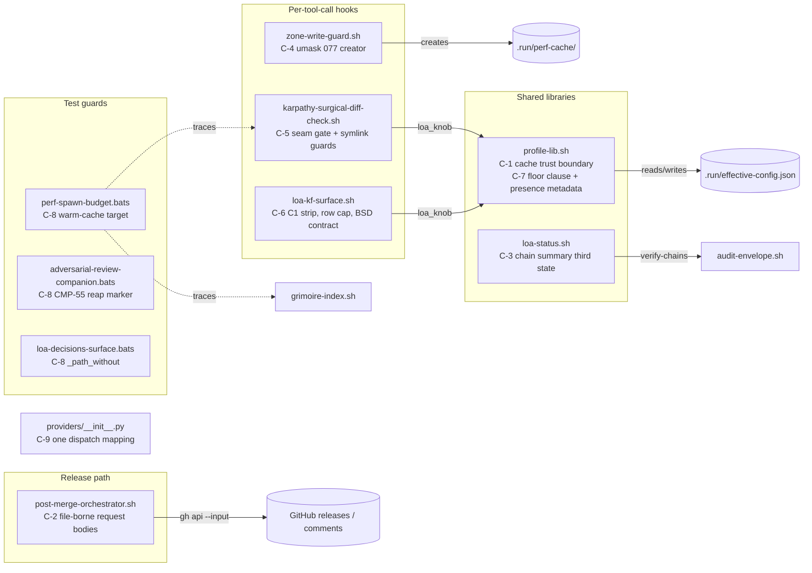

# Software Design Document: Hardening follow-ups (cycle-138)

**Version:** 1.4
**Date:** 2026-10-29
**Revision:** 1.4 (Sprint 284 review round 1, dissent DISS-C-003, DEC-1181): the SessionStart `loa-context-class.sh` hook is the automatic repair owner of a legacy group/other-writable `.run` (`chmod go-w` once per session; grimoire-index stays the on-demand owner) and every hook creator of `.run` runs its `mkdir` under umask 077, pinned by a static guard test (`run-dir-creators.bats`). 1.3 (grounding corrections from the Flatline sprint review and the implementer briefs): the chain-summary tests live in `tests/unit/audit-envelope-verify-chains.bats` (LS-1 … LS-4), not `loa-status-providers.bats`; the FR-3 counts are split — JSON `valid` EXCLUDES n/a and `valid + absent + broken + not_applicable == 7`, the displayed count adds n/a back so the healthy line stays 7/7 (DEC-1171); the cache-state surface is a new `loa_profile_cache_state` function appended to /loa's Profile line only when the cache is off (`loa_profile` keeps printing the name; no JSON profile object exists today); the anchored realpath check runs only when the seam is redirected and the bats marker is absent. 1.2 integrates the Flatline SDD review of 1.1 (6 blockers, 37 medium items from two voices; cross-scoring degraded, KF-041 — dispositions in § 11.F): the publisher's bodies reach `jq --rawfile` through process substitutions (no temp file, no trap — the 1.1 helper's function-scoped RETURN trap would have deleted the file before use); the profile-lib predicate states its trust lifetime, creates an absent `.run` itself and names grimoire-index as the repair owner of a legacy writable `.run`, and every remaining 'tightening' reference now reads REFUSE; the trajectory guard is anchored at the canonical checkout root with one stat over every component below it; the `loa_knob` kind token moves to the last line with a newline guard; the KF top-K selection is specified for awks without `asort`; `audit_chain` gains `not_applicable`. 1.1 carried PRD 1.1's Flatline integration into the design (§ 11.G).
**Author:** Architect Agent (Claude Fable 5.1, unattended)
**PRD Reference:** `grimoires/loa/prd.md` (1.3, FR-1 … FR-16, G-1 … G-4, Appendices D–E)
**Status:** Draft — autonomous cycle on the operator's instruction of 2026-10-29
**Cycle:** `cycle-138-hardening-followups`, branch `feature/cycle-138-hardening-followups` from `main` fe52be893
**Integration context:** `grimoires/loa/a2a/integration-context.md` is absent; the cycle-137 and sprint-bug-283 artefacts (`grimoires/loa/archive/cycle-137-performance-followups/`, `grimoires/loa/a2a/sprint-282/`, `grimoires/loa/a2a/bug-20261028-90f357/`) are the prior art every component below cites.

---

## Table of Contents

1. Project Architecture
2. Software Stack
3. Database Design
4. UI Design
5. API Specifications
6. Error Handling Strategy
7. Testing Strategy
8. Development Phases
9. Known Risks and Mitigation
10. Open Questions
11. Appendix

---

## 1. Project Architecture

### 1.1 System Overview

Fifteen bounded changes to an existing bash/awk/python framework, grouped into ten components (C-1 … C-10) that touch six System Zone files, one Python package and five test files. Nothing new is deployed; every component is a hardening of a path that already runs on the maintainer's machine: three per-tool-call hooks (zone-write-guard, karpathy, the KF SessionStart surface), two shared libraries (`profile-lib.sh`, `loa-status.sh`), the post-merge publisher, and the test guards that keep them honest.

> From prd.md: "Every change keeps its hot path's spawn budget … where output changes by design (FR-3, FR-7) the change is enumerated; everything else is byte-identical old-versus-new" (§ Non-Functional Requirements → Performance).

### 1.2 Architectural Pattern

The cycle-137 pattern, unchanged: **fast path with a verbatim fallback, trust boundary before any cache read or write, red-first tests with a parity harness in real directories, manifests regenerated per System Zone commit**. Where cycle-137 introduced a boundary for one cache (`_gi_trusted_dir`, `_gi_dec_write`), this cycle applies the same boundary to its older sibling and the same "inputs through files, never argv" rule sprint-bug-283 established for the publisher's read-back to its write side.

### 1.3 Component Diagram



### 1.4 Components

| ID | Component | Files | PRD |
|---|---|---|---|
| C-1 | profile-lib cache trust boundary | `.claude/scripts/lib/profile-lib.sh` | FR-1 |
| C-2 | publisher file-borne request bodies | `.claude/scripts/post-merge-orchestrator.sh` | FR-2 |
| C-3 | chain summary third state | `.claude/scripts/loa-status.sh` | FR-3 |
| C-4 | umask-077 perf-cache creators | `.claude/hooks/safety/zone-write-guard.sh` (+ any other creator found by `grep -rn 'perf-cache' .claude --include='*.sh'` that runs `mkdir`) | FR-4 |
| C-5 | karpathy seam gate + trajectory symlink guards | `.claude/hooks/quality/karpathy-surgical-diff-check.sh` | FR-5, FR-6 |
| C-6 | KF surface: C1 strip, row cap, BSD contract | `.claude/hooks/loa-kf-surface.sh`; `.claude/scripts/grimoire-index.sh` (`SAN_AWK` twin only) | FR-7, FR-8, FR-9 |
| C-7 | profile-lib floor descendant clause + presence metadata | `.claude/scripts/lib/profile-lib.sh` | FR-10, FR-11 |
| C-8 | test guards | `tests/unit/perf-spawn-budget.bats`, `tests/unit/adversarial-review-companion.bats`, `tests/unit/loa-decisions-surface.bats` | FR-12, FR-13, FR-14 |
| C-9 | provider dispatch mapping | `.claude/adapters/loa_cheval/providers/__init__.py` | FR-15 |
| C-10 | ship | PR, Bridgebuilder, merge, record, archive (no publish) | FR-16 |

> Sources: prd.md § Technical Considerations → Architecture; the file anchors in each FR

---

## 2. Software Stack

### 2.1 Languages and runtimes
bash 5.2 on the ship host, bash 3.2 compatibility kept where the touched file already has it (hooks: no associative arrays, no `${var,,}`, `[[ ]]` only); awk (mawk 1.3.4, busybox awk, `gawk --posix`; BWK one-true-awk for C-6 form (a)); jq 1.7 (≥ 1.6 for `$ARGS`); mikefarah yq 4.44.1; python3 3.13 (`-I` for the publisher's helpers, as sprint-bug-283 did); bats-core 1.13.0 via the npx cache (`/home/merlin/.cache/npm/_npx/cd2c4d46c11457b7/node_modules/.bin`).

### 2.2 Build and verification
`red-test-check.sh --env-pass PYTHONUSERBASE` per red commit; `tools/gen-checksums.sh --root`, `--check`, `repo-map-gen.sh` + `--validate`, `tools/check-manifest-paths.sh`, `check-loa.sh` under the bounded zone marker (`~/.cache/loa/cycle-137/scripts/regen-manifests.sh` is the recipe); `perf-spawn-budget.bats`; mirror parity in REAL directories (`mirror-ls.py` pattern: python writes, because the shell fence refuses `cp`/redirects into any path containing `.claude/`).

### 2.3 External services
GitHub through `gh` (PR, checks, merge; the publisher's `gh api --input -` already reads request JSON from stdin — C-2 only moves how that JSON is *built*). No model calls on any hot path; the dissent and Bridgebuilder voices are the cycle's review tooling, not the product.

> Sources: `grimoires/loa/a2a/sprint-282/e2e.md` § Measurements (host); `grimoires/loa/a2a/bug-20261028-90f357/reviewer.md` (python3 -I, temp-dir pattern)

---

## 3. Database Design

No database. One existing file cache changes its trust rules (C-1) and one directory its creation mode (C-4):

| File | Owner | Reader | Writer rule (C-1) | Trust rule (C-1) |
|---|---|---|---|---|
| `.run/effective-config.json` (`schema_version 1`, `id`, `knobs`, `profile_keys`, `overrides`, `warnings`) | `profile-lib.sh` | `_loa_pl_load`, `loa_knob` warm path | `umask 077` subshell; `mktemp "$cache.XXXXXX"` beside the cache; `[[ ! -L cache ]]` re-check; `mv -f -T` (fallback `mv -f` only when the target is neither a directory nor a symlink); the rename replaces a planted file or hard link, never truncates through it; failure removes the temp and leaves the cache untouched; an absent `.run` is created by the writer with `mkdir` (no `-p`) inside the same `umask 077` subshell and is trusted by construction (a concurrent creation fails `mkdir` → cache off for this process); `[[ -O dir && ! -L dir && ! -L cache ]]` (builtins, zero spawns) is re-checked right before the rename | **trust predicate** (PRD 1.1 FR-1, DEC-1157): (a) the cache's directory is a real directory (`-d && ! -L`), owned by `$EUID`, with no group/other write bit — a writable or foreign directory is REFUSED (cache off, live read); profile-lib never `chmod`s from the hook path (the D-5.3 tightening stays in `grimoire-index.sh`); (b) the cache file, when present, is a regular non-symlink file owned by `$EUID`, no group/other write bit, link count 1 — else not read, replaced on the next write; (c) a redirected `LOA_PROFILE_CACHE_FILE` outside bats keeps its WARN and its directory must satisfy (a) with no symlinked path component (`realpath -m` of the directory equals `realpath -m` of the checkout root joined to the relative path — anchored at the trust root, so only components below it are constrained); the predicate is evaluated once per process from the stat rows below and its **trust lifetime is the process**: every sampled property (owner, mode bits, file type, link count) can be changed afterwards only by the same uid or by root — both outside the threat model — and replacing `.run` itself needs write permission on the checkout root, the trust root (D-1.2, DEC-1166); the directory rows never enter the cache `id`, so a directory that becomes trusted again simply reads its existing cache when the file half passes (no rebuild on a mode change) |
| `.run/perf-cache/` | `zone-write-guard.sh` (first creator on a fresh mount), grimoire-index (`_gi_dec_write`, already 077) | the caches of cycle-137 | created inside `( umask 077; mkdir -p … )` by every creator (C-4) | unchanged readers (`_gi_trusted_dir`) |

**Spawn budget for C-1.** `_loa_pl_id` already runs one `stat -Lc '%n|%y|%s'` over the three source files; the trust predicate extends THAT call with the cache's directory and the cache file as fourth and fifth paths and the format `|%a|%u|%h` (mode, uid, link count; BSD: `stat -Lf '%N|%Fm|%z|%Lp|%u|%l'`), parses the two extra rows keyed by `%n` — `stat -L` prints a row for every path that exists and exits non-zero for the missing ones, so the call's rc is ignored and presence comes from the rows (a missing cache file or a missing `.run` yields no row; today's 'no id' branch stays for the three source rows only); a mode that is not `^[0-7]+$` or a uid/link count that is not `^[0-9]+$` marks the row malformed and refuses before any shell arithmetic — and excludes them from the cache `id` (ids stay byte-identical to today's, so the cache is not rebuilt by a mode change). Ownership is read from the stat row rather than `[[ -O ]]` so the fixtures can shim it. Net: **zero additional spawns** on the warm karpathy path (budget stays 196 / 9); no `chmod` is ever issued from profile-lib (DEC-1157). The `realpath -m` check for a redirected cache path runs only when `LOA_PROFILE_CACHE_FILE` is set outside bats (one spawn on that seam path only).

> Sources: `.claude/scripts/lib/profile-lib.sh:50-83, 181-222`; `.claude/scripts/grimoire-index.sh:263-331`; `.claude/hooks/safety/zone-write-guard.sh:255-264`; DEC-1126

---

## 4. UI Design

Command-line text only. Three operator-visible changes, each enumerated in the sprint report and the CHANGELOG `[Unreleased]`:

| Surface | Before | After (C-3, C-6) |
|---|---|---|
| `loa-status` human line | `Audit chain: 7/7 primitives validate.` (absence counted valid) | `Audit chain: 7/7 primitives validate.` only when every chain file exists and verifies; otherwise `Audit chain: V/7 validate (A absent, B broken).` followed by one line per non-valid primitive (`  L4 trust-ledger.jsonl: absent`) |
| `loa-status --json` `agent_network` | `audit_chain_summary: "V/7"` | `audit_chain_summary: "V/7"` (V now excludes absent) **plus** `audit_chain: {valid, absent, broken, not_applicable, total, primitives[]}` (`valid` EXCLUDES the two `n/a` primitives — 5 when healthy; `valid + absent + broken + not_applicable == total`; the displayed `V/7` adds n/a back — DEC-1171) |
| KF SessionStart table | every entry (65 today) | at most `KF_SURFACE_MAX_ROWS` (40) rows — selected by recurrence desc, id desc, printed in file order — then `  … and K more — see grimoires/loa/known-failures.md` |
| /loa Profile line (`display_profile_line`, loa-status.sh ≈ 991-1016) | profile, overrides, guardrail notes | plus ` · profile cache off (<reason>)` ONLY when the cache is off (C-1, via the new `loa_profile_cache_state`; byte-identical when on; the hooks themselves stay silent; no JSON profile object exists today, so none is added) |
| profile-floor WARN lines | ancestor and glob matches | plus descendants of mapping-level floor keys (C-7) — pre-flight over the live config expects no newly forbidden key, so no live change |

No colour-only signal (`agent-ergonomics-color-guard.bats`). Everything else byte-identical.

> Sources: `.claude/scripts/loa-status.sh:481-522`; `.claude/hooks/loa-kf-surface.sh:88-140`; prd.md § User Experience

---

## 5. API Specifications

No network API changes. The "APIs" here are the shell-function contracts each component changes; pseudocode is the specification.

### 5.1 `profile-lib.sh` cache trust boundary (C-1)

```
_loa_pl_paths():            unchanged (root, cfg, prof, floor, cache path; LOA_PROFILE_CACHE_FILE seam)
_loa_pl_id():
  st = stat -Lc '%n|%y|%s|%a|%u|%h' -- cfg prof floor "$cachedir" "$cache" 2>/dev/null     # GNU; BSD: -Lf '%N|%Fm|%z|%Lp|%u|%l'
  # rc IGNORED: stat prints a row for every path that exists and exits non-zero for the missing ones — presence comes from the %n rows (M32)
  rows keyed by %n: the three source rows (all required, else no id — today's branch); dirrow for cachedir (optional); filerow for cache (optional)
  _LOA_PL_CUR_ID = "v1|cfg|prof|floor|" join(source rows with the |%a|%u|%h suffix stripped, ";")      # id bytes identical to today
  _LOA_PL_DIR = {mode, uid} from dirrow | absent | malformed;  _LOA_PL_FILE = {mode, uid, links} from filerow | absent | malformed
  fail-closed parse (M11): mode must match ^[0-7]+$, uid and links ^[0-9]+$ — anything else is "malformed" and is refused below, never reaching arithmetic
_loa_pl_cache_trusted():   # 0 → the directory may be used; 1 → cache off for this process (reason in _LOA_PL_CACHE_OFF for loa_profile)
  [[ -n "$cache" ]] || { reason=no-cache-path; return 1; }
  dir = cache's directory
  [[ "$_LOA_PL_DIR" == absent ]] && { if [[ -e "$dir" || -L "$dir" ]]; then reason=dir-stat; else reason=dir-absent; fi; return 1; }   # dir-absent is handled by the writer
  [[ "$_LOA_PL_DIR" == malformed ]] && { reason=dir-stat; return 1; }
  [[ -d "$dir" && ! -L "$dir" ]] || { reason=dir-not-plain; return 1; }
  [[ "$dir_uid" == "$EUID" ]] || { reason=dir-foreign; return 1; }
  (( (8#$dir_mode & 8#022) == 0 )) || { reason=dir-writable; return 1; }                  # REFUSE — never chmod from here (DEC-1157); repair owner: grimoire-index (§ 5.4)
  if the seam is set outside bats:
    real=$(realpath -m -- "$dir" 2>/dev/null); root_real=$(realpath -m -- "$root" 2>/dev/null)
    [[ -n "$real" && -n "$root_real" && "$real" == "$root_real/${dir#"$root/"}" ]] || { reason=dir-symlinked-component; return 1; }   # anchored at the trust root (M31); no realpath -m → refuse; runs only when the seam is redirected AND the bats marker is absent (inside bats the seam's mktemp dir is trusted); tests call this helper directly with the marker unset
  return 0
_loa_pl_cache_readable():  # the file half, for reads only
  [[ "$_LOA_PL_FILE" == absent ]] && { reason=file-absent; return 1; }
  [[ "$_LOA_PL_FILE" == malformed ]] && { reason=file-untrusted; return 1; }
  [[ -f "$cache" && ! -L "$cache" ]] || { reason=file-untrusted; return 1; }
  [[ "$file_uid" == "$EUID" && "$file_links" == 1 ]] || { reason=file-untrusted; return 1; }
  (( (8#$file_mode & 8#022) == 0 )) || { reason=file-untrusted; return 1; }
_loa_pl_load():
  … if cache set and id set and _loa_pl_cache_trusted and _loa_pl_cache_readable:
       j = jq -c 'if .schema_version == 1 and .id == $id then . else empty end' < "$cache"
  … else build; _loa_pl_write_cache
loa_knob() warm path: the same two guards before the jq read of the cache file
_loa_pl_write_cache():
  if ! _loa_pl_cache_trusted; then
    [[ "$_LOA_PL_CACHE_OFF" == dir-absent ]] || return 0
    ( umask 077; mkdir -- "$dir" ) 2>/dev/null || return 0         # no -p: a directory that appeared meanwhile is NOT ours → cache off this process (M32)
  fi                                                                # a directory we just created is trusted by construction (0700, our uid)
  ( umask 077
    [[ -O "$dir" && ! -L "$dir" && ! -L "$cache" ]] || exit 1       # builtin re-check right before the rename — zero spawns (B3)
    tmp=$(mktemp "$cache.XXXXXX") || exit 1
    printf '%s\n' "$_LOA_PL_JSON" > "$tmp" &&
      { mv -f -T "$tmp" "$cache" 2>/dev/null || { [[ ! -d "$cache" && ! -L "$cache" ]] && mv -f "$tmp" "$cache"; }; } || rm -f "$tmp" )
  return 0
loa_profile_cache_state(): prints on | off (<reason>) — appended to /loa's Profile line only when off; loa_profile keeps printing the profile name (its caller captures it)
  reason ∈ no-cache-path · dir-absent · dir-stat · dir-not-plain · dir-foreign · dir-writable · dir-symlinked-component · file-absent · file-untrusted
```
Outcomes (M10):

| Finding | Read | Write |
|---|---|---|
| directory refused (any `dir-*` reason except `dir-absent`) | not read | not written; the directory is untouched (no chmod, no mkdir) |
| `dir-absent` | — | created 0700 by `mkdir` (no `-p`), then written |
| file absent | miss → build | written |
| file is a symlink, FIFO, foreign-owned, multi-linked, or group/other-writable regular file | not read | REPLACED by the rename (the directory entry, never the target: a symlink's target and a hard link's other name keep their bytes) |
| file is a directory | not read | not written (`mv -T` fails; the fallback refuses `-d`) |

Inside bats the `LOA_PROFILE_CACHE_FILE` seam keeps today's semantics (its directory is a 0700 `mktemp -d`, so the predicate passes); outside bats a redirected cache obeys the predicate and the anchored `realpath` component check. **Trust lifetime** (B3): the predicate's properties can be changed after sampling only by the same uid or by root — a same-uid adversary already owns the session (DEC-1136's reasoning) and root is out of scope — and replacing `.run` needs write permission on the checkout root, the trust root; the lifetime is therefore the process, written into the code comment, and the writer's builtin re-check is a belt, not the argument. **Drift guard** (M28): the test extracts both bodies and compares exactly these invariant lines between `profile-lib.sh` and `grimoire-index.sh:263-269` — the `[[ -d … && ! -L … ]]` type check, the `^[0-9]+$` / `^[0-7]+$` field validation, the `== "$EUID"` comparison and the `(( (8#mode & 8#022) == 0 ))` arithmetic; the bodies differ by design after that point (grimoire-index `chmod go-w`s, profile-lib refuses) and the guard compares only the listed lines. One `loa_profile_cache_state` case per reason asserts the exact `off (<reason>)` text, and PL-14 asserts the Profile line's suffix only when off — D-1.1 (DEC-1148), D-1.2 (DEC-1166), DEC-1157.

> Sources: `profile-lib.sh:50-83, 181-262`; `grimoire-index.sh:263-280, 319-331`; `grimoires/loa/a2a/sprint-282/auditor-sprint-feedback.md` MED-001

### 5.2 Publisher request bodies off argv (C-2, `post-merge-orchestrator.sh`)

```
phase_release (1286):
  request = jq -nc --arg tag "$tag" --rawfile body <(printf '%s' "$notes") --arg title "$release_title" --argjson pre "$prerelease" \
            '{tag_name:$tag, name:$title, body:$body, draft:false, prerelease:$pre}'
  gh api … --method POST … --input - <<< "$request"                     # (as today: --input - reads stdin)
phase_notify (1488, 1502): the same for "$summary" — --rawfile body <(printf '%s' "$summary") for the POST and for the read-back comparison
  jq -e --argjson id "$id" --rawfile body <(printf '%s' "$summary") --arg issue "$issue_url" '.id == $id and .body == $body and .issue_url == $issue'
```
`--rawfile` takes a path; a bash process substitution supplies `/dev/fd/N` (a named pipe on a host without `/dev/fd`), fed by the `printf` builtin in a forked subshell — the body is never on any argv, no file is created, nothing is cleaned up and no trap exists. The 1.1 design (a helper `_pm_body_file` printing a temp path and owning a `RETURN` trap that removed the directory, "in its own scope") was wrong and is withdrawn: a function-scoped RETURN trap fires when THAT function returns, so the file would have been deleted before the caller's `jq` ran, and under `functrace` it would have clobbered the caller's trap instead (Flatline B1/B4/B6, § 11.F). jq reads each `--rawfile` operand fully while parsing its arguments, before any input, so the writer never blocks on a full pipe past jq's start; a jq failure (bad argument, no memory) hands `gh api … --input -` an empty request, which fails with today's `fail_phase release "Release creation failed"` / `fail_phase notify "Comment creation failed"` — the failure path is unchanged and no temp storage exists to fail (M7). `printf '%s'` writes no trailing newline, so `--rawfile` yields exactly the string `--arg` carried; the comparison semantics are unchanged (byte-exact for the comment; the release body goes through `release_body_identical` as of sprint-bug-283, whose temp files are created, used and removed inside ONE function scope — the only place the temp-dir + RETURN-trap pattern remains). The implementation task enumerates every argv-borne body site with `grep -n -- '--arg body\|--arg summary\|--arg notes' post-merge-orchestrator.sh` (three at fe52be893: 1286, 1488, 1502) and converts each; afterwards that grep shows none and `grep -c -- '--rawfile body <(printf' post-merge-orchestrator.sh` is 3 (structural assertions in the test file). Tests assert the stub-recorded argv of every publish-path command carries no body marker (replacing a `bash -x` grep; M15/M19) — D-2.1 (DEC-1149) as amended by D-2.2 (DEC-1165).

> Sources: `post-merge-orchestrator.sh:1286, 1488-1502` at fe52be893; `grimoires/loa/a2a/bug-20261028-90f357/engineer-feedback-r2.md` § Observations 4; `getconf ARG_MAX` 2 097 152, per-argument 131 072

### 5.3 Chain summary third state (C-3, `loa-status.sh:408-461, 481-522`)

```
_an_audit_chain_classify():  prints one line per primitive: "<id> <path|-> <state>"   state ∈ valid | absent | broken | n/a
  for L1 L2 L3 L4 L6 (chain-bearing): missing file → absent; present → verified below
  records = audit-envelope.sh verify-chains <existing…>     # contract (loa-status.sh:440-452 at fe52be893; M20): one JSON record per argument {i: <0-based index>, path: <the path passed at i>, ok: <bool>};
            # index k is valid only when EXACTLY ONE record has .i == k, .path == $p[k] and .ok == true — a duplicate, missing or unexpected index is broken (M5);
            # rc 0 or 1 → records parsed; any other rc, or unparsable output → every existing chain broken; an empty existing list skips the call (A = 5, V = 2)
  per existing path: ok:true → valid; else (fails, unreadable, malformed, no record) → broken
  L5, L7 (no chain file by design) → n/a           # EXCLUDED from the JSON valid count; added back for the DISPLAYED count (DEC-1171)
_an_audit_chain_summary():   prints the DISPLAYED "V/7" with V = valid + not_applicable, A = absent, B = broken; V + A + B == 7 always (asserted per fixture); the classification carries A, B and the JSON valid (n/a excluded)
display: if A == 0 && B == 0 → "Audit chain: ${V}/7 primitives validate."                  # byte-identical to today in the healthy case
         else → "Audit chain: ${V}/7 validate (${A} absent, ${B} broken)." then one line per non-valid primitive: "  ${id} ${basename}: ${state}"
JSON: audit_chain_summary: "${V}/7" (string kept; V excludes absent), audit_chain: {valid: <verified chains — n/a EXCLUDED, 5 when healthy>, absent: A, broken: B, not_applicable: 2, total: 7, primitives: [{id, path, state}]}   # valid + absent + broken + not_applicable == total; displayed V = valid + not_applicable (DEC-1171)
```
Behaviour change (intended, enumerated): an absent chain file no longer counts as valid, so `7/7` requires every chain-bearing file to exist and verify; the non-healthy line names each absent or broken primitive — D-3.1 (DEC-1150), D-3.2 (DEC-1167). Fixtures cover verifier exit 0, 1 and 2, duplicate / missing / unexpected index records, and the empty existing list.

> Sources: `loa-status.sh:408-461, 481-522`; `tests/unit/audit-envelope-verify-chains.bats` LS-1 … LS-4 (roots `r0`, `r3`, `r5`, `r3-partial`, `none`; `_summary`, `_oracle`, `_stub` helpers; `store-tampered.yaml`)

### 5.4 umask-077 creators (C-4)

`zone-write-guard.sh:261`: `[[ -d "${cache_dir}" ]] || ( umask 077; mkdir -p -- "${cache_dir}" )`. The sprint's first task enumerates every `mkdir` that can create `.run/perf-cache`, `.run` itself or any directory under it — `grep -rn 'perf-cache' .claude --include='*.sh' --include='*.py'` AND `grep -rn 'mkdir.*\.run' .claude tests --include='*.sh' --include='*.py'` (M34) — and applies the same subshell to each: zone-write-guard.sh:261 (the known creator); the karpathy hook's `mkdir -p "$STATE_DIR"` (line 162) and `mkdir -p "$TRAJ_DIR"` (line 214 — rewritten by C-5's guard, § 5.5); profile-lib's cache writer `mkdir -p "$dir"` (line 186 — rewritten by C-1, § 5.1); `grimoire-index.sh` already uses umask 077. **Repair owner for a legacy writable `.run`** (B2, M33): a `.run` that already exists 775 (an older creator under umask 002) is refused by profile-lib and repaired by `grimoire-index.sh` — `_gi_dec_cache_on` calls `_gi_trusted_dir "$ROOT/.run"`, whose last line `chmod go-w`s a uid-owned writable directory (lines 266-270 at fe52be893) — on its next run (on demand, `bash .claude/scripts/grimoire-index.sh`, or through the index-regeneration paths); until then `loa_profile_cache_state` reports `off (dir-writable)` (the /loa Profile line carries it) and every hook falls back to the live read with identical output. **1.4 (Sprint 284 review, DISS-C-003, DEC-1181):** the on-demand owner alone left every umask-002 install cache-off until someone ran grimoire-index, and the SessionStart `loa-context-class.sh` was itself the first 775 creator of `.run` on a fresh checkout; it is now the automatic repair owner — a real, non-symlink, uid-owned `.run` with a group/other write bit is `chmod go-w`-ed once per session (the `_gi_trusted_dir` invariant lines; one `stat` per session start; a symlink is never followed, a foreign directory is left alone) — and every hook creator of `.run` (`loa-context-class.sh`, `write-mutation-logger.sh`, `mutation-logger.sh`, `run-mode-stop-guard.sh`, `block-destructive-bash.sh` ×2, `settings-cleanup.sh`, `zone-write-guard.sh`; the karpathy hook under its global `umask 077`) runs its `mkdir` inside `( umask 077; … )`, pinned by `tests/unit/run-dir-creators.bats` (RDC-1 static guard over `.claude/hooks`; RDC-2 … RDC-5 dynamic: fresh root 0700, 775 → 755 repair with unchanged output, symlink untouched, 700 sees no chmod). The C-1 matrix carries a 775 `.run` row: cache off before, on after one grimoire-index run; the CHANGELOG line names the repair. `umask` is a builtin → no spawn — D-4.1 (DEC-1151), D-1.2 (DEC-1166).

### 5.5 karpathy seam gate and trajectory guards (C-5)

```
line 62:  CHECKPOINT="$REPO_ROOT/.claude/scripts/run-checkpoint.sh"
          [[ -n "${BATS_TEST_FILENAME:-}${BATS_VERSION:-}" && -n "${KARPATHY_CHECKPOINT_CMD:-}" ]] && CHECKPOINT="$KARPATHY_CHECKPOINT_CMD"
          # outside bats the variable is ignored (no stderr: the hook's output stays byte-identical)
lines 214-217 (the warn path only — the hot path is untouched; the state dir and task file at lines 162/165 keep today's -L guards: out of FR-6's scope, M21):
  _traj_trusted():      # spawns on the WARN path only: realpath ×2 (root, TRAJ_DIR) + stat ×1 (+ mkdir once when the directory is absent); ZERO on the hot path (M18)
    root_real=$(realpath -m -- "$REPO_ROOT" 2>/dev/null); real=$(realpath -m -- "$TRAJ_DIR" 2>/dev/null)
    [[ "$TRAJ_DIR" == "$REPO_ROOT/"* ]] || return 1                                                  # outside the checkout → refuse (inside bats the seam's mktemp dir IS the root)
    [[ -n "$root_real" && -n "$real" && "$real" == "$root_real/${TRAJ_DIR#"$REPO_ROOT/"}" ]] || return 1   # anchored at the canonical root: only components BELOW it are constrained (M31); no realpath -m (BSD) → refuse (M14)
    comps = every directory from the first component below REPO_ROOT down to TRAJ_DIR inclusive    # default: grimoires, grimoires/loa, grimoires/loa/a2a, grimoires/loa/a2a/trajectory
    [[ -d "$TRAJ_DIR" ]] || { ( umask 077; mkdir -p -- "$TRAJ_DIR" ) 2>/dev/null || return 1; }     # 0700 by us; already-existing parents are checked below
    f="$TRAJ_DIR/karpathy-${TS:0:10}.jsonl"
    st=$(stat -Lc '%n|%u|%a|%h' -- "${comps[@]}" "$f" 2>/dev/null)       # ONE stat (BSD: -Lf '%N|%u|%Lp|%l'); rc ignored, rows keyed by %n; the file row is optional
    for each comp: row present, [[ -d comp && ! -L comp ]], uid == EUID, (mode & 022) == 0 — else return 1   # a missing component row → return 1 (B5)
    file row present: [[ -f f && ! -L f ]], uid == EUID, links == 1, (mode & 022) == 0 — else return 1      # FIFO, device, directory, symlink, hard link, writable, foreign (M12)
    fields validated with ^[0-9]+$ / ^[0-7]+$ before any arithmetic
  _traj_trusted && printf … >> "$f" 2>/dev/null || true                    # the warning line is printed regardless
```
The seam is honoured only under a bats marker and otherwise ignored silently (PRD 1.1 FR-5, DEC-1158); `perf-spawn-budget.bats` adds `BATS_TEST_FILENAME` to its `env -i` allowlist for the karpathy target so its stub checkpoint still applies — D-5.1 (DEC-1152). **Threat model of the gate** (M24): `BATS_VERSION` and `BATS_TEST_FILENAME` are ordinary variables anyone with the same uid can export; the gate is a footgun guard against an ambient `KARPATHY_CHECKPOINT_CMD`, not a security boundary — the same uid already owns the session. The trajectory guard (PRD 1.2 FR-6) is anchored at the canonical checkout root and reads every component below it plus the day file in one `stat`; the `perf-spawn-budget.bats` karpathy fixture exercises the HOT path (no warning), so "budget unchanged" holds by construction, and one test asserts the warn path's own spawn count once (not a budget line) — D-5.2 (DEC-1168). A BSD command shim (no `realpath -m`, `stat -f`) fixture asserts the refusal with the warning printed.

> Sources: `karpathy-surgical-diff-check.sh:38-62, 153-165, 205-220`; `profile-lib.sh:57-67` (seam precedent); `perf-spawn-budget.bats:275`

### 5.6 KF surface: C1 strip, row cap, BSD contract (C-6, one awk program in `loa-kf-surface.sh`; `SAN_AWK` twin in `grimoire-index.sh`)

```
san(s):   gsub(/\000/, "", s)
          gsub(/\302[\200-\237]/, " ", s)          # NEW: UTF-8 C1 (U+0080–U+009F) → space — the decisions jq `s` class
          gsub(/\342\200[\250\251]/, " ", s)       # NEW: U+2028, U+2029 → space — the rest of that class; `<>` are NOT replaced here (stated)
          gsub(/[\001-\010\013\014\016-\037\177]/, "", s)
          gsub(/[\t\n\r]/, " ", s); gsub(/  +/, " ", s); sub(/^ /, "", s); sub(/ $/, "", s)
          return substr(s, 1, 100)                 # BYTE cap under LC_ALL=C: 100 bytes on every host, may end inside a multi-byte sequence (advisory text) — the FR-9 contract
rows:     collected in file order with (recurrence as the leading integer, 0 when absent; id); at END:
          if n <= max: print all rows in file order                                    # byte-identical to today
          else: top-K WITHOUT asort (mawk, busybox and BWK have none; M36): max passes of a linear scan over the unselected rows, each picking the best by
                (rec desc, idnum desc) where idnum = substr(id, 4) + 0 and rec = the leading integer of the recurrence field, 0 when absent or malformed (M3);
                an exact tie (only a duplicated id) resolves to the earlier file position; mark it selected; then print the SELECTED rows in file order;
                print "  … and " n-max " more — see grimoires/loa/known-failures.md"
```
`KF_SURFACE_MAX_ROWS=40` is a shell constant passed with `-v max=`; no config key (PRD § Constraints); selection and display order are separate (DEC-1159) so the live file (65 entries) changes only by its 25 elided rows plus one line — the enumerated diff for FR-7's parity criterion; every field is bounded — id matches `^KF-[0-9]+$` (the parser's filter), recurrence prints as an integer (malformed reads 0), symptom ≤ 100 bytes — so 40 worst-case rows plus header and elision line stay under 8 KiB by construction (fixture; M2). `LC_ALL=C` is pinned on the awk command itself at every call site of both twins — the hook does so at line 94; grimoire-index's `SAN_AWK` call sites (lines 101, 177, 191) get the same prefix — with a parity case run from a `LANG=en_US.UTF-8` parent (M35). The 100-byte cap contract is DEC-1159's; the boundary fixture asserts the split sequence is tolerated downstream (advisory text; M26). The drift guard keeps `san()` and `SAN_AWK` identical; the three-awk parity test runs mawk, busybox and `gawk --posix`; FR-9 form (a) adds a BWK awk — a prebuilt one first (`original-awk` package, `nawk`, a container), the source build second — and BSD `cut` semantics; form (b) only after the prebuilt attempt is recorded, closing bd-aceil with the contract landed and opening a linked macOS bead — D-6.1 (DEC-1153), D-6.2 (DEC-1154), D-6.3 (DEC-1169), DEC-1159.

> Sources: `loa-kf-surface.sh:88-140`; `grimoire-index.sh` `SAN_AWK`; `grep -c '^## KF-' known-failures.md` = 65; DEC-1123; DEC-1146

### 5.7 profile-lib floor clause and presence metadata (C-7)

```
forbidden($k):  any($floor[]; . as $f | ($k | test($f | globre))
                                      or (($f | split("*")[0]) | startswith($k + "."))                       # ancestor (today)
                                      or (($f | contains("*") | not) and ($k | startswith($f + "."))))      # NEW: descendant of a MAPPING-LEVEL floor key — entries without *; glob entries rely on test(globre) alone (M37)
loa_knob internal read (warm cache, memo): jq prints the rendered value FIRST and the kind token (present|absent|miss|stale) as the LAST line
   out=$(jq -r … '… | if …stale… then "stale" elif has($k) then (if .knobs[$k].source == "absent" then "absent" else ((.knobs[$k].value | render) + "\npresent") end) else "miss" end')
   if [[ $out == *$'\n'* ]]; then kind="${out##*$'\n'}"; value="${out%$'\n'*}"; else kind="$out"; value=""; fi
   value="${value%"${value##*[!$'\n']}"}"       # today's command-substitution bytes: trailing newlines stripped
   # $(…) strips trailing newlines, so with the token LAST an empty present value gives out=$'\npresent' → kind=present, value="" (M8/M30);
   # a non-present kind has no newline → value=""; a value equal to "miss"/"absent"/"stale" is a value because kind says present
```
The public contract `loa_knob <path> <fallback>` (19 call sites, 10 files) is unchanged; `__LOA_PL_*` sentinel strings disappear from the code — D-7.1 (DEC-1155), D-7.2 (DEC-1170). Pre-flight for the descendant clause (M17): a jq over the live `.loa.config.yaml` and profile against the floor lists every key the new clause newly forbids — expected `none` (a sprint-report line; the plan's "live floor list identical" criterion).

> Sources: `profile-lib.sh:131, 236-288`; `grep -rn loa_knob .claude --include=*.sh` = 19; Sprint 282 review observation 3; Bridgebuilder #1309 R-002

### 5.8 Test guards (C-8)

- `perf-spawn-budget.bats`: a second `_trace` of the grimoire-index fixture after the first (the cache now warm) with its own budget line (`grimoire-index --tsv warm N/M`), reason stated; the fixture's `.run/perf-cache` is created 0700 and uid-owned so `_gi_trusted_dir` admits it, and the cache file's presence is asserted before the second trace (otherwise the hit assertion tests nothing; M29); the assertion that the trace shows no `yq -o=json` on the hit; the warm budget is measured over three runs at implementation and pinned with the file's headroom rule (M6).
- `adversarial-review-companion.bats` CMP-55 (line 1678): the wrapped `_adv_kill_tree` writes a marker (`: > "$T/reap-attempted"`) before returning 1; the test asserts the marker; the test's own `CMP_STUB_HOLD_S=300` override is removed so `setup()`'s 240 applies; `LOA_ADVERSARIAL_COMPANION_WAIT_SECONDS` goes from 3 to 6 (the value the reaped case at line 1087 uses; M29); the serial TAP set stays identical.
- `loa-decisions-surface.bats` `_path_without`: `local -a skips=("$@")` before `local IFS=:`; `for t in "${skips[@]}"`; a `_path_without yq jq` case.

### 5.9 Provider dispatch mapping (C-9, `providers/__init__.py:26-60`)

Bound and tests (M23): the 60-line bound is `git diff --numstat` added + deleted on `__init__.py`; one test imports every adapter once and asserts the static `_AUTH_KIND` table agrees with each adapter class's declared auth kind; `cheval --help` timing band = hyperfine, 10 runs, against the eso-loop report's baseline, allowed regression ≤ 10 % of the mean (M6).

Today: `_ADAPTER_MODULES` (class → module), `_ADAPTER_TYPES` (type → class name), `__getattr__` building `_ADAPTER_REGISTRY` lazily. Target: one `_registry()` function returning the cached type→class dict used by `get_adapter`, `cli_adapter_types` and the `_ADAPTER_REGISTRY` attribute; `cli_adapter_types` derived from a static `_AUTH_KIND` table (`type → api|cli`) instead of instantiating adapters; presence tests `name in globals()` instead of `globals().get(name) or …` (a falsy cached object would re-import). Implement only if the diff stays ≤ 60 lines with every existing provider test green and `cheval --help` inside the loop's band; otherwise defer by a class-S row (DEC-1146) — D-9.1.

### 5.10 Ship (C-10)
cycle-137's § Ship S-1 … S-4 and S-8 (PR body from a template; Bridgebuilder with the exclusion list; `merge-pr.sh`-style gate; `record-branch.sh`; `archive-cycle.sh` on a chore branch); S-5/S-6/S-7 (publish) are NOT run; the PR body states that the prepared rc.10 candidate stays unpublished.

> Sources: `~/.cache/loa/cycle-137/ship/` scripts; `grimoires/loa/a2a/sprint-282/e2e.md` Part 2

---

## 6. Error Handling Strategy

| Situation | Behaviour | Rationale |
|---|---|---|
| C-1 trust check fails (foreign uid; writable dir — REFUSED, never tightened from profile-lib; symlinked dir or file; FIFO; malformed stat row) | cache off for this process; live read; no stderr; the /loa Profile line names the reason | fail-open on the hot path with today's exact behaviour; a refusal must never change a knob's value (DEC-1136 reasoning); trust lifetime = the process (D-1.2) |
| C-1 `.run` absent | the writer creates it 0700 with `mkdir` (no `-p`) inside the umask subshell; a concurrent creation fails `mkdir` → cache off this process | a directory we created is trusted by construction |
| C-1 legacy writable `.run` (775) | cache off, `loa_profile_cache_state` → `off (dir-writable)` on the Profile line; repaired at the next session start by `loa-context-class.sh` (`chmod go-w`, DEC-1181) or by grimoire-index on demand | two repair owners (§ 5.4); profile-lib never chmods (DEC-1157) |
| C-1 writer cannot `mktemp`/`mv` | temp removed, cache untouched, function returns 0 | never fatal inside a hook |
| C-2 jq cannot build the request (bad argument, no memory) | the pipeline hands `gh api … --input -` an empty request → API error → today's `fail_phase` text | unchanged failure path; no temp storage exists to fail (D-2.2) |
| C-3 `verify-chains` exits other than 0/1 or prints unparsable records | `ok_count 0` → every existing chain counts broken; absent counted separately | more conservative than per-call, never a false 7/7 |
| C-5 any component below the root or the day file fails the guard, or `realpath -m` is unavailable | the warning line is still printed; the append is skipped silently | fail-open for the user, closed for the write |
| C-6 awk program fails on a host (BWK) | the hook's existing fail-open (`|| true`) prints nothing; the drift guard and three-awk parity catch it in tests | unchanged |
| C-9 refactor exceeds its bound | deferred by a class-S row; bead stays open | DEC-1146 |

---

## 7. Testing Strategy

| Component | Red-first tests (file) | Parity harness | Guard |
|---|---|---|---|
| C-1 | `profile-lib.bats`: foreign-owned `.run` (stat shim); group-writable uid-owned `.run` REFUSED — no chmod issued (a recording `chmod` shim sees no call, the mode is unchanged) and `loa_profile_cache_state` reports `off (dir-writable)` (Profile line suffix); a 775 `.run` admitted after one grimoire-index run; absent `.run` created 0700 by the writer; symlinked cache not read and REPLACED on the next write (target bytes unchanged); planted temp-name symlink never followed (victim unchanged); FIFO at the cache path not opened; hard-linked cache not read; malformed stat row refused; one `loa_profile_cache_state` case per reason; drift guard vs `grimoire-index.sh` (the listed lines) | `loa_knob` / `loa_profile` / `_loa_pl_live` on the live config + the pass-19 matrix; karpathy hook stdout/stderr/state files across the matrix (REAL mirror dirs) | `perf-spawn-budget.bats` karpathy target: same count on the warm path |
| C-2 | `post-merge-publication.bats`: multi-byte `release_body` (≤ 125 000 chars, > 131 072 bytes) and `notification_body` (≤ 65 536 chars, > 131 072 bytes), singly and together, publish DONE (one POST each); a jq shim exiting 2 → today's `fail_phase` text and no second POST; structural: no `--arg body|--arg summary|--arg notes`, three `--rawfile body <(printf` sites, no `mktemp` on them; existing 71 unchanged | the stub's argv log for every publish-path command carries no body marker (no `bash -x`) | — |
| C-3 | `audit-envelope-verify-chains.bats` (LS-5 …; `loa-status-providers.bats` only if it asserts the old line): one file deleted → `absent 1`, never 7/7; all present + valid → today's line; one broken → `broken 1`; verifier exit 0 / 1 / 2 fixtures; duplicate, missing and unexpected index records → broken; empty existing list → A 5, displayed V 2; `not_applicable` 2 and JSON `valid` 5 on the healthy root; `_oracle` updated | every other `loa-status` line identical (mirror); `run-preflight.sh` identical | — |
| C-4 | hook test under `umask 002`: fresh dir is 0700; grimoire-index D-5.3 case still green; `run-dir-creators.bats` RDC-1 … RDC-5 (static guard over every hook creator of `.run`; fresh root 0700 for context-class and the audit loggers; 775 → 755 repair with unchanged output; symlink untouched; 700 sees no chmod) | — | spawn budgets unchanged |
| C-5 | karpathy tests: exported `KARPATHY_CHECKPOINT_CMD` ignored without the marker (a counter script is not run), honoured with it; symlinked `TRAJ_DIR`, a symlinked ancestor, a foreign-owned or writable component, the day file as symlink / FIFO / hard link / group-writable → victim unchanged, warning still printed; replacement between two runs refused on the second; BSD shim (no `realpath -m`) → refused; the warn path's spawn count asserted once | hook across the matrix | karpathy budget unchanged (marker added to the allowlist) |
| C-6 | `kf-surface.bats` + `grimoire-index.bats`: C1 fixture → one space; 100-entry fixture → 40 rows + elision line, deterministic order; ≤ 40 entries → byte-identical; byte-cap fixture with a 3-byte UTF-8 symptom at the cap | live file: diff is exactly the elided rows + one line (attached) | kf-surface 36/2 unchanged; drift guard; three-awk (+ BWK) parity |
| C-7 | `profile-floor.bats` / `profile-lib.bats`: mapping-level floor key drops a child and a grandchild with the WARN; a glob floor entry is not widened; a sibling prefix is kept; values equal to the former sentinels, an EMPTY present value and a value with trailing newlines round-trip on the warm, memo and live paths; pre-flight: no key of the live config newly forbidden | live + matrix identical for all 19 call sites | karpathy budget unchanged |
| C-8 | the guards themselves: a deliberately added spawn on the grimoire-index hit branch fails the new target (one-off red run recorded); CMP-55 fails when the reaper is never invoked (one-off red run); `_path_without yq jq` excludes both | — | — |
| C-9 | existing provider tests + one pinned observable (the SDD-named change) or the deferral row | `cheval --help` timing within the loop's band | — |
| C-10 | — | — | checks green on the exact head; no new tag (`git ls-remote --tags` unchanged) |

Whole-head parity gate before each sprint's review: one old mirror (the previous sprint's head) and one new mirror (the sprint head) in REAL directories run every touched entry point over the live inputs; stdout, stderr, rc and written files `cmp` identical except the enumerated changes — the parity exception ledger (M4): C-3's non-healthy line, per-primitive lines and JSON object; C-6's row cap (the live file's 25 elided rows + one line) and C1 fixtures; C-1's Profile-line cache suffix (off case only) and, for the refusal fixtures, the intended difference 'no cache file written' (knob outputs identical); C-5's warn-path fixtures where the asserted difference IS the refused append (victim bytes unchanged); C-7's sentinel-collision, empty-value and descendant fixtures with their expected outputs enumerated per fixture. Full `tests/unit` on each sprint's final head: only the three KF-034 reds; new skips only when named and host-conditional (DEC-1135 rule).

---

## 8. Development Phases

| Phase | Sprint (global) | Content | Order inside the sprint |
|---|---|---|---|
| 1 | 284 | C-1, C-2, C-3, C-4 | C-4 first (smallest; it makes every creator produce a 0700 `.run`, so C-1's REFUSE never triggers on a fresh mount), then C-3, C-2, C-1 (largest blast radius last, with the matrix parity) |
| 2 | 285 | C-5, C-6 | C-5 (two small hook edits), then C-6 as one awk change set: C1 strip → row cap → BSD contract (form a/b) |
| 3 | 286 | C-7, C-8, C-9, C-10 | C-7, then the three guards, then C-9 (or its deferral row), then `reviewer.md`, gates, and the ship |

Each sprint: implementer patches land red → fix under the marker with manifests; `reviewer.md` before `/review-sprint`; ≤ 3 dissent runs (the third is the audit's); `COMPLETED`; the whole-head parity gate and the full suite recorded in the sprint's `e2e.md`.

---

## 9. Known Risks and Mitigation

| Risk | P | I | Mitigation |
|---|---|---|---|
| C-1 refuses the cache on a layout that is common downstream (`.run` created 775 by an older creator under umask 002) | Med | Low | the refusal falls back to the live read (identical output) and the Profile line names `dir-writable`; grimoire-index's `_gi_trusted_dir` tightening repairs a uid-owned `.run` on its next run (the repair owner — named in the CHANGELOG line); a 775 row in the matrix |
| C-2 process substitution on a host without `/dev/fd` | Low | Low | bash falls back to a named pipe; CI (ubuntu) and macOS both have `/dev/fd` |
| C-1 extended `stat` row parsing differs on BSD (`%Lp` vs `%a`) | Low | Med | the existing GNU/BSD branches are extended symmetrically; a stat shim test for each format |
| C-3 wording change breaks a consumer parsing the human line | Low | Low | `audit_chain_summary` kept; healthy-case line byte-identical; new fields additive |
| C-6 row cap hides a KF the session needed | Low | Med | ordering by recurrence then id keeps structural failures first; the elision line names the file |
| BWK awk still unobtainable | High | Low | form (b) exit (DEC-1146) |
| Bridgebuilder companion timeout (KF-037) | Low | Low | host unloaded; retry once after ten minutes; degraded exit only with no blocker |
| Three sprints' gates ≈ 6 h | — | Low | sprint boundaries are HALT-safe |

---

## 10. Open Questions

| # | Question | Default taken (decision row) |
|---|---|---|
| Q-1 | Should the KF row cap be configurable? | No knob in this cycle; constant 40 (D-6.1); a knob only if a downstream asks |
| Q-2 | Should C-5 WARN outside bats instead of ignoring the seam? | Ignore silently (D-5.1); a WARN on a per-tool-call hook is noise |
| Q-3 | Does any creator other than zone-write-guard make `.run/perf-cache`? | Found by grep at implementation; each gets the umask subshell (D-4.1) |
| Q-4 | Is the C-9 refactor worth a System Zone commit? | Only within the 60-line bound (D-9.1); else deferred |

---

## 11. Appendix

### 11.D Design decisions taken on the operator's behalf

| # | Decision | Row |
|---|---|---|
| D-1.1 | C-1 duplicates the ten-line trust check inside profile-lib (no new sourced lib on the hot path) with a drift guard against grimoire-index; the directory mode comes from the existing `_loa_pl_id` stat extended with a fourth path — zero added spawns | DEC-1148 |
| D-2.1 | C-2 uses `--rawfile` from a `printf '%s'`-written temp file per request (sprint-bug-283's temp-dir + RETURN-trap pattern) | DEC-1149 |
| D-3.1 | C-3 keeps `audit_chain_summary` as a string (valid excludes absent), adds `audit_chain {valid, absent, broken, total}`, and keeps the healthy-case human line byte-identical | DEC-1150 |
| D-4.1 | C-4 wraps every perf-cache `mkdir` in a `( umask 077; … )` subshell | DEC-1151 |
| D-5.1 | C-5 honours the checkpoint seam only under a bats marker (no WARN); `perf-spawn-budget.bats` passes the marker | DEC-1152 |
| D-6.1 | C-6 row cap is a constant 40 with recurrence-desc, id-desc ordering and one elision line | DEC-1153 |
| D-6.2 | C-6 C1 strip maps the UTF-8 pair to a space (the jq `s` filter's behaviour), placed before the C0 strip | DEC-1154 |
| D-7.1 | C-7 presence metadata travels as a first-line kind token before the rendered value (no sentinel strings, no extra spawn) | DEC-1155 |
| D-9.1 | C-9 implemented only within a 60-line bound; else deferred (DEC-1146) | DEC-1156 |
| D-2.2 | (1.2) C-2 bodies reach `jq --rawfile` through `<(printf '%s' …)` process substitutions — no temp file, no trap; supersedes D-2.1's mechanism | DEC-1165 |
| D-1.2 | (1.2) C-1 trust lifetime = the process; the writer creates an absent `.run` 0700 with `mkdir` (no `-p`); grimoire-index's existing tightening is the repair owner of a legacy writable `.run` | DEC-1166 |
| D-3.2 | (1.2) C-3 `audit_chain` adds `not_applicable`; the verify-chains contract is pinned | DEC-1167 |
| D-5.2 | (1.2) C-5 trajectory guard anchored at the canonical root, one stat over every component below it plus the day file (mode included); no `realpath -m` → refuse; the gate is a footgun guard, not a boundary | DEC-1168 |
| D-6.3 | (1.2) C-6 top-K by max linear passes (no `asort`), numeric id, malformed recurrence 0, tie → file position; `LC_ALL=C` per awk call | DEC-1169 |
| D-7.2 | (1.2) C-7 kind token on the LAST line with a newline guard; descendant clause only for floor keys without `*` | DEC-1170 |

### 11.E Grounding reads
`.claude/scripts/lib/profile-lib.sh:50-83, 125-145, 181-288`; `.claude/scripts/grimoire-index.sh:263-331`; `.claude/scripts/post-merge-orchestrator.sh:1160-1330, 1480-1510`; `.claude/scripts/loa-status.sh:408-461, 481-522`; `.claude/hooks/safety/zone-write-guard.sh:225-264`; `.claude/hooks/quality/karpathy-surgical-diff-check.sh:38-62, 150-165, 205-220`; `.claude/hooks/loa-kf-surface.sh:88-140`; `.claude/adapters/loa_cheval/providers/__init__.py:20-62`; `tests/unit/perf-spawn-budget.bats:119-275`; `tests/unit/adversarial-review-companion.bats:1678-1691`; `tests/unit/loa-decisions-surface.bats:124-140`; `tests/unit/loa-status-providers.bats` (LS-1); cycle-137 SDD § 3, § 5.5, § 7; `grimoires/loa/a2a/bug-20261028-90f357/reviewer.md`.

### 11.G PRD 1.1 integration (Flatline PRD review carried into the design)
The PRD's Flatline review (Appendix D there) changed six design points, all reflected above: the profile-lib predicate covers the cache file and REFUSES a writable `.run` (§ 3, § 5.1; DEC-1157); the publisher's bodies leave argv and tests assert stub-recorded argv (§ 5.2 — 1.2 replaced the temp-storage mechanism by process substitution, § 11.F B1); the chain summary classifies every primitive with a sum invariant and names the non-valid ones (§ 5.3); the trajectory guard covers components, ownership, type and links on the warn path (§ 5.5); the KF cap separates selection from display and states the byte ceiling and the full control class (§ 5.6); FR-9 form (b) needs a prebuilt-BWK attempt first (§ 5.6, DEC-1159). The halt protocol (DEC-1160) and verdict binding (DEC-1161) are process rules the sprint plan carries.

### 11.F Flatline SDD review dispositions
Run: `flatline-orchestrator.sh --doc grimoires/loa/sdd.md --phase sdd --json` on 1.1, 2026-10-29 (claude-headless + gpt-5.5; voices 2/2; 6 blockers, 37 medium items; cross-scoring degraded — `scoring_degraded true`, `confidence_floor low`; 640 s; 0 cents; KF-041 recurrence 13). Every blocker and item was read; dispositions:

| Id | Theme | Disposition | Where |
|---|---|---|---|
| B1, B4, B6 (BSKP-001/002) | `_pm_body_file`'s function-scoped RETURN trap deletes the file before the caller's jq | ACCEPTED — mechanism replaced by process substitution; helper withdrawn | § 5.2, § 6, § 7, D-2.2 |
| B2 (BSKP-002) | 1.1 still described the chmod/tightening design in § 6, § 7, § 8, § 9; no repair owner under REFUSE | ACCEPTED — every reference rewritten to REFUSE; repair owner = grimoire-index `_gi_trusted_dir` (already tightens `.run`); 775 matrix row | § 3, § 5.4, § 6, § 7, § 8, § 9, D-1.2 |
| B3 (BSKP-003) | trust sampled once per process | ACCEPTED as argued — trust lifetime = the process (only the same uid or root can change the properties; `.run` replacement needs the trust root); builtin re-check before the rename | § 3, § 5.1, D-1.2 |
| B5 (BSKP-004) | trajectory guard ignored intermediate components | ACCEPTED — one stat over every component below the canonical root + the day file | § 5.5, D-5.2 |
| M1, M16 | body file lifetime | ACCEPTED with B1 | § 5.2 |
| M2, M3 | KF field bounds; total order and malformed recurrence | ACCEPTED | § 5.6, D-6.3 |
| M4 | parity exception ledger for C-1, C-5, C-7 | ACCEPTED | § 7 |
| M5, M20, M25 | verify-chains contract, exit codes, `not_applicable` | ACCEPTED | § 5.3, § 7, D-3.2 |
| M6 | numeric warm budget; C-9 timing band procedure | ACCEPTED — measured over three runs then pinned; hyperfine 10 runs ≤ 10 % | § 5.8, § 5.9 |
| M7 | checked jq failure paths | NOTED — today's pipeline already fails the phase (empty request → API error); fixture added | § 5.2, § 6, § 7 |
| M8, M30 | empty present value collapses to the token | ACCEPTED — token LAST + newline guard | § 5.7, D-7.2 |
| M9, M27, M33 | remaining tightening references; repair owner | ACCEPTED with B2 | § 5.4, § 6, § 7, § 8, § 9 |
| M10 | outcomes per finding; which file types are replaced | ACCEPTED — outcomes table | § 5.1 |
| M11, M32 | fail-closed stat parsing; missing rows; who creates `.run` | ACCEPTED | § 3, § 5.1 |
| M12 | refuse a group/other-writable trajectory file | ACCEPTED | § 5.5 |
| M13, M21 | state dir / task file guards | PARTIAL — trajectory fixtures widened; the state dir and task file keep today's `-L` guards (out of FR-6's scope, stated) | § 5.5 |
| M14 | portable component resolution | ACCEPTED — no `realpath -m` → refuse; BSD shim fixture | § 5.5 |
| M15, M19 | § 7 still named `bash -x` | ACCEPTED | § 7 |
| M17 | C-7 descendant clause pre-flight | ACCEPTED | § 5.7, § 4 |
| M18 | C-5 spawn statement | ACCEPTED — counts stated per branch; one stat | § 5.5 |
| M22 | § 3 rebuild contradiction | ACCEPTED — rebuild sentence deleted | § 3 |
| M23 | `_AUTH_KIND` test; bound measurement | ACCEPTED | § 5.9 |
| M24 | C-5 gate threat model | ACCEPTED — footgun guard, not a boundary | § 5.5, D-5.2 |
| M26 | trim the cap to a UTF-8 boundary | REJECTED — DEC-1159 fixed the contract; the fixture asserts downstream tolerance | § 5.6 |
| M28 | drift guard invariant lines; `[[ … (( )) ]]` pseudocode | ACCEPTED | § 5.1 |
| M29 | CMP-55 values; warm fixture's directory mode | ACCEPTED | § 5.8 |
| M31 | anchor realpath at the canonical root | ACCEPTED | § 5.1, § 5.5 |
| M34 | widen the creator search | ACCEPTED | § 5.4 |
| M35 | `LC_ALL=C` per awk call + UTF-8 parent parity | ACCEPTED | § 5.6 |
| M36 | portable top-K | ACCEPTED | § 5.6, D-6.3 |
| M37 | restrict the descendant clause to non-glob entries | ACCEPTED | § 5.7, D-7.2 |

> Sources: `~/.cache/loa/cycle-138/logs/flatline-sdd.json` (`blockers[]`, `medium_value[]`, `verdict_quality`); grimoires/loa/known-failures.md KF-041 (2026-10-29 rows)
